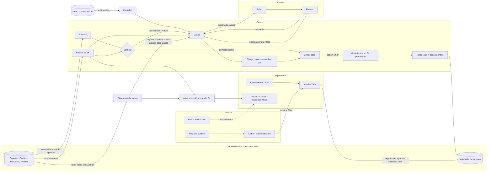

# Procesos de Sistemas · mapa para el rediseño de la pantalla de TI

*21-oct-2026 · Fases 1 a 4 del rediseño: lo que Sistemas hace dentro y fuera de SATAG (entrevista, §5), el sistema actual mapeado, la frecuencia medida y la investigación con los requisitos de diseño (§6). Sigue la Fase 5 (bocetos).*

**Fuentes.**
- Inventario del código: pantallas, RPC y tablas, con su `archivo:línea` en el anexo A.
- Frecuencia: consulta de solo lectura `supabase/manual/2026-10-21_frecuencia_procesos.sql`, corrida en producción el 21-oct. Ventana: del 14-sep al 21-oct (~5.3 semanas, personal real).

**Cómo leer «Ritmo».**
- Se mide por los **días distintos** en que ocurrió, no por el total: 200 movimientos en un solo día es una carga masiva, no trabajo diario.
- Escala:
  - **Diario:** ≥ 9 días de ~27 hábiles.
  - **Semanal:** 4-8 días.
  - **Ráfaga:** muchas veces en ≤ 3 días.
  - **Eventual:** pocas veces.

---

## 1. Los procesos de TI, agrupados por lo que resuelven

**Nivel** = cuántos pasos de navegación hay desde que se entra al panel hasta la acción (pestaña › grupo › vista › sub-vista › diálogo).

### A. Casos: lo que no cuadra entre la pluma, ZK y SATAG

| Proceso | Ritmo medido (veces · días · últ. 7 d · personas) | Dónde vive hoy | Nivel |
|---|---|---|---|
| Notas en casos | **Diario** · 386 · 9 · 45 · 4 | Consulta › Estacionamiento › Casos › detalle | 4 |
| Abrir caso a mano | **Diario** · 55 · 10 · 18 · 4 | Casos «+ Reportar caso», ficha de persona, Nuevo aviso… (6 entradas) | 3-4 |
| Triage (tomar, esperar, consultar con el CP, urgente) | Semanal · 31 a consultar · 6 · 24 | Casos › tablero / detalle | 4 |
| Cerrar caso | Semanal · 71 · 8 · 24 · 1 | Casos › Cerrar… › diálogo | 5 |
| Casos por regla (sin-padron) | Ráfaga · 264 · 3 | Implícito: **solo corre si alguien abre Casos** | — |
| Tipos de caso (editar y ordenar) | Eventual | Casos › «Tipos ▾» | 4 |

### B. Ciclo de ZK: que ZK diga lo mismo que SATAG

| Proceso | Ritmo medido | Dónde vive hoy | Nivel |
|---|---|---|---|
| Subir «Todos los Eventos» | **Diario** · 26 · **13** · 9 · **1** | Consulta › Datos › Archivos de ZK | 3 |
| Pedir movimiento en ZK (departamento, nombre) | Semanal · 93 · 6 · 21 · **1** | Casos › Cerrar… › «Acción en ZK» / detalle › «Pedir acción en ZK…» | 5 |
| Subir Personas (padrón) | Semanal · 11 · 8 · 3 · **1** | Consulta › Datos › Archivos de ZK | 3 |
| Crear tanda + palomear pasos | Semanal · 11 · 5 · 2 · **1** | Consulta › Datos › Movimientos en ZK | 3-4 |
| Subir Personal de Apertura (4 puertas) | Semanal · 28 · 4 · 12 · **1** | Consulta › Datos › Archivos de ZK | 3 |
| Verificar movimientos | Semanal · 47 · 4 | Implícito al subir Personas o Puertas | — |
| Exportar stock / padrón instalado a ZK | **Sin rastro** (solo en el navegador) | TI › TAGs de la escuela › al pie | 3 |
| Altas automáticas desde ZK | Diario · 163 · 12 (automático) | Implícito al subir archivos | — |
| Registrar departamento de ZK | Eventual | Movimientos en ZK › «Departamentos» | 4 |

### C. Expedientes: atender a la persona

| Proceso | Ritmo medido | Dónde vive hoy | Nivel |
|---|---|---|---|
| Actualizar datos (cambio) | **Diario** · 62 · 10 · 20 · **10 personas** | TI › Actualizar datos; chip del padrón; ficha | 3-4 |
| Instalar TAG | Semanal (lunes) · 33 · 6 · 8 · 4 | TI › Instalar TAG (primera tarjeta del inicio) | 3 |
| Asignar TAG del inventario | Semanal · 38 · 8 | Dentro de Instalar | 4 |
| Rectificar (depuración) | Ráfaga · 127 · 4 · 5 personas | Ficha › área administrativa; herramientas de Campo | 4 / fuera |
| Dar de alta TAGs al inventario | Ráfaga · 42 · 3 | TI › TAGs de la escuela | 3 |
| Dar de baja | Eventual · 6 · 2 | TI › Dar de baja (tarjeta del inicio) | 3 |
| Reposición | Eventual · 2 · 2 | TI › Actualizar datos › «Usar TAG apartado» | 4 |
| Revisar incompletos | Sin rastro (lectura) | TI › Expedientes incompletos y Consulta › Personas | 2-3 |
| Cotejar la firma | Sin rastro | Al pie de cada tarjeta | 4 |

### D. Buzón: lo que piden las familias

| Proceso | Ritmo medido | Dónde vive hoy | Nivel |
|---|---|---|---|
| Atender o vincular solicitud | **Cero desde el 14-sep** | TI › Notas sin expediente (tarjeta del inicio) | 3 |
| Descartar solicitud | Cero | Tarjeta de la nota | 4 |

### E. Caseta: el canal con los porteros (nuevo, 14 al 21-oct)

| Proceso | Ritmo medido | Dónde vive hoy | Nivel |
|---|---|---|---|
| (Portero) buscar un vehículo | 80 en 5 días · 1 persona | Pestaña Caseta | 1 |
| Dar seguimiento a reportes / ligar apertura | 7 reportes | Consulta › Estacionamiento › Caseta: reportes y avisos; Aperturas con botón | 3-4 |
| Avisar a la caseta / retirar | 1 | Detalle del caso y Caseta: reportes y avisos | 3-5 |

### F. GES: quién es cada persona

| Proceso | Ritmo medido | Dónde vive hoy | Nivel |
|---|---|---|---|
| Subir archivo de GES | Eventual · 3 · 1 día | Consulta › Datos › Archivos de GES | 3 |
| Decidir identidad | Sin rastro histórico (quitar borra) | Ficha › Datos; caso › Identificación | 4-5 |

### G. Lo que hace Administración y pasa por TI

- Alta por el registro público: 42 · 6 días.
- Cobro: 41 · 6 días. Con cada cobro llega un aviso al Chat de TI.
- Validar tipo: 41.
- Devoluciones y cortes de caja: **cero** desde el 14-sep.

---

## 2. Cómo se comunican los procesos

**Las tres cadenas que mueven todo:**
1. **Familia → caja → instalar → ZK.** Ritmo semanal, los lunes. Es el proceso original de SATAG.
2. **ZK → SATAG → casos → ZK.** Ritmo diario. Subir archivos alimenta los casos, los casos piden movimientos, las tandas los llevan a ZK y el siguiente padrón verifica: lo que no coincide reabre su caso. **Es un ciclo cerrado que hoy cruza 3 pantallas y 1 sola persona lo opera.**
3. **Caseta ↔ casos.** El portero reporta y la caseta recibe avisos. Es nueva y va creciendo.

---

## 3. Lo que dice el mapa (hallazgos medidos)

1. **La pestaña TI está organizada alrededor del proceso de agosto, no del de hoy.**
   - Su inicio pone al frente Instalar (semanal), Actualizar, Dar de baja (6 en 5 semanas), Notas del buzón (**cero**), Inventario e Incompletos.
   - El trabajo **diario** está todo en otra pestaña («Consulta»), a nivel 3-5: casos, subir Eventos y el ciclo de ZK.
2. **«Consulta» dice «vista de solo consulta» y es donde más se escribe.** Casos, archivos de ZK, movimientos, GES, caseta y área administrativa escriben en la base desde ahí. El rótulo contradice el uso.
3. **El ciclo de ZK está partido en tres lugares**: Archivos de ZK, Casos › Cerrar… y Movimientos en ZK. Además TI › TAGs exporta a ZK por su cuenta. Hay **dos exportes distintos a ZK** (padrón instalado y tanda) y saltos explícitos entre pestañas («Ir a Archivos de ZK»).
4. **Bus factor = 1 en lo más frecuente.** Todo el ciclo de ZK lo hizo una sola persona en 5 semanas. La pantalla nueva tiene que **guiarlo** (qué toca hoy, qué falta, en qué paso va) para que lo pueda hacer otra persona de TI.
5. **Una regla depende de que alguien abra una pantalla.** «Sin-padron» solo abre casos si alguien de TI o de Contabilidad entra a Casos con la bitácora cargada.
6. **Duplicados que cuestan aprendizaje:**
   - «Abrir caso» tiene 6 entradas.
   - El detalle de caso tiene 2 componentes distintos (tablero y ficha).
   - Hay 2 «Padrón completo» y los incompletos aparecen en 2 lugares.
   - «Pedir acción en ZK» está en 2 lugares, igual que «Ligar apertura» y «Avisar a la caseta».
7. **Procesos sin rastro, que no se pueden medir:** exportes a ZK, cotejar firma, copiar la consulta de GES y retirar TAG del inventario (borra la fila). Si importan para el diseño, conviene registrarlos.
8. **Docs desactualizados.** `05 - Flujos del Sistema.md` no menciona casos, ZK, GES ni caseta.

---

## 4. Matriz frecuencia × criticidad (preliminar, falta la Fase 1)

| | **Crítico** (si no se hace, alguien abre o no abre la pluma por error) | **Importante** | **Accesorio** |
|---|---|---|---|
| **Diario** | Subir Eventos · casos (notas, triage, cerrar) · actualizar datos | Caseta (reportes, avisos) | — |
| **Semanal** | Ciclo ZK (movimientos, tanda, padrón, puertas, verificar) · instalar | Inventario | Tipos de caso |
| **Eventual** | Baja · reposición | GES · rectificar · departamentos ZK | Buzón (0) |

**Regla de diseño que se desprende:**
- Lo de la fila *Diario* va **a un clic** desde que se entra.
- Lo *Semanal*, **a dos**, y guiado.
- Lo *Eventual*, buscable pero fuera del primer plano.
- Nada a más de dos niveles (la guía de Carbon que ya se usó en el benchmark del 14-oct).

---

## 5. Fuera de SATAG (Fase 1, entrevista con Gerardo, 21-oct)

| Qué | Cómo pasa hoy | Ritmo | Qué implica para el diseño |
|---|---|---|---|
| **Ajustes directo en ZK** | Los compañeros con años en ZK corrigen ahí casos únicos porque les es más sencillo. SATAG se descuadra, aunque no pasa mucho. | Eventual, casos sueltos | No pelear con el hábito: SATAG debe **detectar y absorber** lo que cambió en ZK sin pedirse. El padrón subido ya lo ve; falta mostrarlo como «cambios hechos en ZK» para confirmar o corregir en un paso. |
| **Reportes de la caseta por WhatsApp** | El portero se los manda a Gerardo y él los registra a su nombre. | Mientras los porteros no tengan cuenta | Es temporal: con las cuentas, la caseta los reporta sola. Mientras tanto, TI debería poder registrar «lo reportó la caseta por WhatsApp» sin firmarlo como suyo. |
| **Hoja / papel** | Solo cuando hay que instalar TAGs a mano; cada vez llegan menos en papel. | Eventual, a la baja | La captura desde papel no merece primer plano, pero debe existir (hoy no tiene pantalla). |
| **GES** | Se hizo una vez. | Eventual | Fuera del primer plano. |

### Quién usa la pestaña TI (entrevista, 21-oct)

| Persona (rol) | Para qué entra | Ritmo |
|---|---|---|
| **Operador diario de Sistemas** (Gerardo) | Todo: casos, ciclo de ZK, caseta, expedientes, instalar | Diario |
| **Instaladores** (Lidia, Ángel, Miguel) | Instalar TAGs | Semanal (lunes) |
| **Quien decide casos** (Miguel) | Empieza a usar los casos | Va empezando |

Son dos formas de usar la pantalla:
- **El día de instalar**: tres personas, una tarea clara, poco aprendizaje.
- **La operación diaria**: una persona hoy, que debe poder pasar a otra.

El diseño tiene que servir a las dos sin que una estorbe a la otra.

### Lo que más estorba hoy (Gerardo)

1. **Buscar dónde está algo**: el trabajo está repartido entre TI y Consulta.
2. **El ciclo de ZK partido** en pantallas distintas, y solo él lo sabe hacer.
3. **No ver qué toca hoy** al entrar.

Lo que **no** estorba: lo que tarda Casos en abrir. Medido, sí tarda, pero no es prioridad.

### El buzón

**Todavía no se abre al público**: por eso no ha recibido nada. Se queda en el diseño como bandeja que se activa cuando abra, sin ocupar primer plano mientras tanto.

## 6. Investigación (Fase 4)

### 6.1 Consolas de operación: ServiceNow SOW, Zendesk, Jira SM, Linear, Intercom, Front

*Fuente: Gemini, 21-oct. El informe no trae fuentes verificables: se toman los patrones, que coinciden con el benchmark del 14-oct, y no sus cifras.*

| Patrón de la industria | ¿Aplica a SATAG? | Cómo se traduce aquí | Resuelve |
|---|---|---|---|
| **Página de inicio con tarjetas de lo pendiente** (ServiceNow Landing, colas con conteo de JSM) | **Sí, es el centro** | «Hoy»: casos nuevos, reportes de la caseta sin seguimiento, avisos esperando respuesta, estado del ciclo de ZK (último archivo hace N días, movimientos pendientes, tanda por verificar), instalaciones pendientes los lunes | «No ver qué toca hoy» |
| **Colas / vistas filtradas** con conteo y antigüedad, en vez de una bandeja global (Zendesk Views, JSM Queues) | Sí | Cada tarjeta de «Hoy» abre su cola ya filtrada. Sin SLA formal: la antigüedad («lleva N días») hace de SLA | «Buscar dónde está algo» |
| **Playbook con etapas y actividades** (ServiceNow Playbooks, transiciones de JSM) | **Sí, es la pieza nueva** | El ciclo de ZK como un solo playbook: 1 Subir archivos → 2 Revisar casos → 3 Pedir movimientos → 4 Tanda en ZK → 5 Verificar. Cada etapa con su estado y su botón | «Ciclo de ZK partido» y bus factor = 1 |
| **Lista + detalle en el mismo lugar** (split pane de Linear, 3 paneles) | Ya existe | El tablero de casos ya lo hace: se conserva | — |
| **Búsqueda global / paleta de comandos** (Cmd+K en Linear e Intercom) | Sí | Un buscador único de persona, placa, TAG o caso, desde cualquier pantalla | «Buscar dónde está algo» |
| **Macros** (Zendesk, Intercom) | Parcial | «Cerrar con acción en ZK» ya funciona como macro; después, plantillas de cierre frecuentes | Velocidad |
| Triage con IA | **No** | Las reglas deterministas (sin-padron, caseta) ya clasifican; con este volumen la IA no se justifica | — |
| Pestañas internas con varios registros abiertos | No | 1 a 4 usuarios con poco volumen: complejidad sin retorno | — |
| Presencia omnicanal, conversaciones laterales | No | Las notas del caso bastan para Sistemas y el CP | — |
| SPA de baja latencia | Parcial | Lo único medible: que Casos no espere la bitácora completa (no está entre lo que más estorba) | — |

### 6.2 Control de acceso y seguridad física (Genetec, Brivo, Kisi, Verkada, LenelS2, ZK)

*Fuente: Gemini, 21-oct. El informe trae marcadores «[cite: …]» sin enlaces: se toman los patrones y no las cifras.*

| Patrón | ¿Aplica? | Cómo se traduce en SATAG |
|---|---|---|
| **Separar la operación en vivo de la administración** (Genetec: Security Desk / Config Tool; Verkada y Brivo: un solo panel filtrado por rol) | Sí, al estilo de la nube (un solo panel por rol) | La caseta ya es la «operación en vivo» aparte. Dentro de TI: lo diario arriba; lo que configura (tipos de caso, departamentos de ZK, alta al inventario) abajo y más profundo, **profundidad proporcional al riesgo** |
| **«Mantener sincronizado» / «Anular»** (Genetec marca el perfil que se desvió del directorio maestro) | **Sí, resuelve el hallazgo de la entrevista** | Los ajustes que los compañeros hacen directo en ZK: el padrón subido los detecta; la persona queda marcada «ZK distinto de SATAG» y aparece en una lista para **aceptar lo de ZK** o **corregir ZK** en un paso |
| **El riesgo central es el acceso huérfano** (bajas que siguen abriendo) | Sí | Contador fijo en «Hoy»: bajas y exempleados que abrieron la pluma desde el último archivo. Hoy existe como tipo de caso, no como alerta visible |
| **Píldoras de estado en listas** (verde activo, rojo suspendido, gris inactivo; Brivo, Kisi) | Sí | Un solo juego de píldoras para todo el panel (los tokens --ok/--warn/--alert del 15-oct) |
| **Taxonomía de avisos** (Atlassian: banner = toda la sesión, modal = destructivo, toast = acción hecha, pastilla = estado) | Sí | Banner solo para «el archivo de ZK lleva N días sin subirse»; modal solo para cerrar o retirar en lote; lo demás en línea |
| **Nada crítico en tooltips**; mensajes en línea visibles | Sí | Revisar: los puntos de la línea de tiempo de Aperturas usan `title`; la lista de abajo ya repite el dato |
| **Revelación progresiva / asistentes** para sincronizar padrones (Brivo, Genetec) | **Sí, es el playbook de ZK** | Subir archivos paso a paso: primero solo lo que toca hoy; los detalles (freno, «aplicar de todos modos») se despliegan al necesitarse |
| **Navegación por frecuencia y riesgo**; la regla de los 3 clics es un mito: importa el «olor de la información» (NN/g) | Sí | Lo diario a profundidad 0-1, lo semanal a 1-2, la configuración a 3+. **Rótulos que digan la verdad** (hoy «Consulta: vista de solo consulta» es donde más se escribe) |
| **Migas de pan en lo profundo** (Atlassian) | Sí | Ya se usan en Estacionamiento; extenderlas a todo nivel ≥ 2 |
| **Asignación masiva por filtro** (LenelS2) | Parcial | Ya existe para cerrar casos en bloque; después, para pedir movimientos de ZK en bloque |
| **Auto-exportación programada** (ZKBioSecurity «Transaction Auto-Export») | **Por verificar en la versión de ZK del Instituto** | Si ZK puede mandar «Todos los Eventos» solo cada día (a una carpeta o un correo), la tarea **más frecuente de TI** (13 de 27 días, 1 persona) deja de ser manual. El API de ZK está bloqueado por licencia; la auto-exportación sería otra vía |
| SCIM / sincronización con directorio | No | No hay directorio corporativo; GES es manual y eventual |

### 6.3 Requisitos del diseño (lo que sale de las Fases 1-4)

1. **Al entrar, «Hoy»**: lo pendiente con su conteo y antigüedad. Cada tarjeta abre su cola filtrada: casos nuevos; reportes de la caseta sin seguimiento; avisos esperando; bajas que siguieron abriendo; ciclo de ZK; instalaciones del lunes.
2. **El ciclo de ZK en un solo lugar y guiado (playbook)**: subir archivos → revisar → pedir movimientos → tanda → verificar. Cada etapa dice si está al día, qué falta y el siguiente paso, para que otra persona de TI lo pueda hacer.
3. **Un buscador único**: persona, placa, TAG o caso, desde cualquier pantalla.
4. **Dos modos sin estorbarse**: el día de instalar (tres personas, una tarea) y la operación diaria.
5. **Profundidad por frecuencia y riesgo**: diario 0-1, semanal 1-2, configuración 3+. Nada diario fuera de la pestaña de TI.
6. **Rótulos verdaderos**: lo que escribe no se llama «Consulta».
7. **Desincronización visible**: lo que cambió en ZK sin pedirse, para aceptar o corregir.
8. **Sin pérdida**: todo proceso actual sigue existiendo. El buzón queda como bandeja que se activa cuando abra.

## 7. La UX (Fase 5, 21-oct)

**Primera ronda.** Bocetos A, B y C en imagen (tableros con cuadros). A Gerardo no le convenció ninguno. El problema de fondo: eran **tableros para mirar**, y el trabajo de Sistemas es **resolver cosas una tras otra**. La segunda ronda cambia el modelo y se prueba como **prototipo HTML interactivo**, que vive fuera del repo.

### 7.1 Modelo: bandeja de trabajo, no tablero
- Al entrar, una **lista de tareas concretas, cada una con su verbo**: «Subir los archivos de ZK de hoy», «Tomar 4 casos nuevos que nadie ha visto», «La caseta abrió con el botón a… y la pantalla decía No tiene acceso».
- Cada tarea **se resuelve ahí mismo**, en un panel a la derecha, y **sale de la lista** al terminar. El avance se ve arriba («5 de 9 hechas hoy») y la meta es la bandeja en cero.
- Las tareas **se calculan del estado**, no se capturan. Si el archivo de ZK se sube por cualquier camino, la tarea desaparece sola y cuenta como hecha.

### 7.2 Prioridad de la bandeja
| Grupo | Qué entra | Por qué |
|---|---|---|
| **Ahora: afecta quién abre la pluma** | La caseta abrió con botón cuando decía «No tiene acceso» · bajas que abrieron · archivos de ZK atrasados | Riesgo de acceso huérfano (§6.2) |
| **Hoy** | Casos nuevos sin tomar · aperturas no identificadas · el paso en curso del ciclo de ZK | Lo diario medido (§1) |
| **Esta semana** | Avisos sin respuesta · instalar (lunes) · verificar la tanda | Lo semanal medido |

La antigüedad siempre se ve («14 días» en rojo cuando pasa de 7) y hace de SLA.

### 7.3 Arquitectura de información

**Barra lateral única** (patrón Carbon / Verkada; nada a más de 2 niveles):
- **Bandeja**
- **Casos**: lista filtrada; el tablero de columnas queda como vista opcional.
- **Ciclo de ZK**: los 5 pasos.
- **Caseta**: reportes, avisos y aperturas.
- **Personas**: búsqueda y lo que no cuadra.
- **Instalar**: el lunes.
- Separado abajo, **Configurar**: tipos de caso, departamentos de ZK, inventario, GES y caseta. Es lo eventual y de riesgo, con profundidad a propósito.

**«Consulta» deja de mezclar.** Lo que escribe se va a las secciones de arriba. Consulta queda para **medir** (Estacionamiento, tablero de instalación), con su rótulo de solo lectura por fin verdadero.

### 7.4 Patrones de interacción
- **Lista + panel de trabajo** a la derecha, sin cambiar de pantalla.
- **Una acción principal por tarea**; las secundarias, al lado y en contorno.
- **Deshacer en vez de confirmar**: el aviso de abajo trae «Deshacer» durante 5 segundos. Solo lo destructivo o en bloque pide confirmación.
- **Siguiente paso sugerido** al terminar uno (sobre todo en el ciclo de ZK).
- **Decidir en bloque** donde el patrón lo permite (los 28 «departamento distinto»), además de uno por uno.

### 7.5 Ciclo de ZK (el playbook)
Cinco pasos con estado (al día / atrasado / nunca):
1. Archivos
2. Decidir casos
3. Tanda
4. Hacerla en ZK
5. Verificar

Cada archivo dice **la ruta exacta en ZK**. Los pasos manuales en ZK son una **lista para palomear**: el botón «Listo» se activa al palomear todo. Verificar cierra los casos solo. Es lo que permite que otra persona de TI lo haga.

### 7.6 Búsqueda Ctrl K
Encuentra personas (nombre, placa, TAG, folio), casos (C-630) y **acciones** («subir archivos», «instalar», «nuevo aviso»). Es la respuesta a «buscar dónde está algo».

### 7.7 Instalar (lunes)
Pantalla limpia solo con las familias que pagaron, la placa grande y un botón por familia. El panel es una lista de 4 puntos: vehículo, TAG del inventario (propone el siguiente), pluma y **firma cotejada**. Al marcar la firma, **queda rastro**; hoy cotejarla no deja ninguno. Al terminar el día propone «Descargar archivo para ZK».

### 7.8 ZK distinto de SATAG
Lo que los compañeros cambian directo en ZK aparece en Personas como **«ZK distinto de SATAG»**, con dos botones: **Vale lo de ZK** o **Corregir ZK** (pide el movimiento para la siguiente tanda). Es el patrón «Mantener sincronizado / Anular» de Genetec.

### 7.9 Estados, texto y accesibilidad
- **Vacío**: «✓ Bandeja en cero», como logro.
- **Carga**: lo guardado primero; nada de esperar la bitácora completa para ver la bandeja.
- **Errores**: en línea, nunca solo en un tooltip.
- **Texto**: verbos, de usted, sin jerga sin explicar. «Tanda» siempre con lo que es: el archivo para ZK.
- **Accesibilidad**:
  - foco visible (ámbar);
  - nada solo con color (la antigüedad lleva número, el estado lleva texto);
  - botones de 38 a 44 px;
  - teclado completo: Ctrl K, J/K, Enter, Esc, G B, ?

### 7.10 Cómo se sabrá si funciona (métricas)
1. **Saber qué toca hoy: 0 clics** (se ve al entrar).
2. **El ciclo de ZK lo completa otra persona de TI sin ayuda.** Hoy lo hace 1 persona en 5 semanas.
3. **Casos nuevos con más de 7 días: 0.** Hoy el más viejo lleva 14.
4. **Tareas diarias a 1 clic y semanales a 2**, desde la bandeja.
5. **Ninguna escritura vive en «Consulta».**

### 7.11 Revisión de Gerardo al prototipo 1 (21-oct) → prototipo 2

**Respuestas a las preguntas abiertas:**
- **Sistemas ve todo, todos.** Es una sola bandeja compartida, con quién hizo qué: «el día que yo falte, todo debe seguir funcionando».
- **Lo más usado es instalar los lunes, por todos.**
- **Inventario bajo cuenta como «Ahora».** Avisa con menos de ~8 TAGs, y el umbral sale del uso de los lunes pasados. Prototipo: `máx(8, 1.5 × promedio de los últimos 4 lunes)`.
- **Miguel decide desde Casos y desde la búsqueda de personas**, como ya lo hace.
- Queda por decidir el umbral de «archivo de ZK atrasado» (el prototipo usa 7 días).

**Decisiones:**
- **Casos e Instalar se quedan como están.** Instalar es cómodo en el celular. No se mueven los procesos que ya se usan y funcionan.
- **El concepto gusta pero no está pulido**: todavía no se implementa.
- **Lo que más gusta es el ciclo de ZK.** Pregunta clave: cómo se ve de instalar un TAG a exportar e importar el padrón a ZK, con **los pasos en SATAG y en ZK** hasta que todo quede limpio.
- **Incidente real del lunes 20:** se dio de alta a una docente y no se hizo «quitar y poner los niveles». ZK quedó mal y nadie se enteró. El diseño tiene que atrapar esto.

**Prototipo 2: el ciclo de ZK por lotes**
- Todo lo que se hace en SATAG y debe llegar a ZK va en un **lote**:
  - las altas de cada lunes (salen solas de Instalar);
  - los cambios decididos en casos (salen solos de «Cerrar… con acción en ZK»);
  - las correcciones de «ZK distinto de SATAG».
- Cada lote avanza por 5 pasos marcados **SATAG** o **ZK**:
  1. hecho en SATAG
  2. descargar el archivo
  3. importar en ZK (con su ruta exacta)
  4. **quitar y volver a poner niveles, una casilla por departamento**
  5. **comprobar**
- **Comprobar** = subir «Personal de Apertura» de las 4 puertas: SATAG revisa persona por persona si abre donde debe. Quien no abre aparece en **«Ahora»**, nombrando el departamento al que le faltan niveles. Con eso, el incidente del lunes 20 habría salido en la bandeja.
- El lote no se cierra hasta que todos abren: «✓ ZK igual que SATAG».
- Archivo de prueba: `ti-prototipo-v2.html`, fuera del repo.

## 9. Plan de implementación (21-oct, aprobado el prototipo v2)

**Principio.** Cada fase se publica sola y deja SATAG funcionando. Lo que hoy funciona (Instalar, Casos, Caseta, Personas) **no se rediseña**: cambia de lugar o se le conecta algo. Cada fase cierra con `verificar` y `build` en verde, `publicado` y una prueba con una **cuenta ti real**, no super.

**Lo que ya existe y se reutiliza.**

| Pieza del prototipo | Ya existe en la base | Falta |
|---|---|---|
| Lote con pasos SATAG / ZK | `zk_tandas.pasos`: importar + **un paso de niveles por departamento** (bloque 93) | Que las **altas** y las **bajas** entren a las tandas |
| Comprobar con las puertas | `verificar_movimientos_zk` compara con Personas y Personal de Apertura (93/94) | Comprobar las altas: que el TAG abra las puertas de sus plumas |
| Archivos de ZK y su antigüedad | `zk_importaciones`, `zk_padron_cargas`, `zk_puertas_cargas` | Mostrarlos como «sensores» |
| Inventario y uso de los lunes | `inventario_tags`, `registros.fecha_instalacion` | El umbral y el aviso |
| Bandeja | Todo se deduce de lo anterior y de casos y caseta | La pantalla |
| Hecho hoy, por quién | Rastros con `hecho_por` en movimientos, casos_notas, zk_*, caseta | Juntarlos en una lectura |

### Fase 1 · El armazón de TI y la Bandeja (solo cliente, sin SQL)
- **Pestaña TI con barra lateral** en escritorio y **pestañas abajo** en el celular:
  - Bandeja
  - Ciclo de ZK: por ahora junta las pantallas actuales de Archivos de ZK y Movimientos en ZK.
  - Casos: el tablero de hoy.
  - Instalar: la pantalla de hoy de TI, con Actualizar, Baja, Notas, Inventario e Incompletos.
  - Caseta: Reportes y avisos.
  - Personas.
  - Configurar: tipos de caso, departamentos de ZK, alta al inventario y GES.
- **Acceso fijo «＋ Instalar N»** arriba y **franja de Instalar** al frente de la Bandeja.
- **Bandeja v1**, calculada en el navegador con lecturas que ya existen:
  - la caseta abrió sin acceso;
  - aperturas sin identificar;
  - casos nuevos con su antigüedad;
  - archivos de ZK atrasados;
  - **inventario bajo**: `máx(8, 1.5 × promedio de TAGs de los últimos 4 lunes)`;
  - movimientos de ZK pendientes y tandas abiertas.
- **«Hecho hoy, por quién»**, juntando los rastros del día.
- **Consulta** conserva todo lo que hoy tiene, para no romper hábitos; las entradas de escritura quedan también en TI.
- *Riesgo:* bajo. Es mover y conectar, sin cambios en la base.

### Fase 2 · Las altas y las bajas también pasan por ZK (SQL)
- **Bloque 101 (AGREGA):**
  - `zk_movimientos.que` admite `alta` y `baja`.
  - Instalar crea su movimiento `alta` hacia el departamento que le toca. Mismo criterio que el exporte de hoy (`lib/zk/plantillaZk.ts`).
  - Dar de baja crea `baja` hacia BAJAS. Hoy una baja **no** toca ZK: es el riesgo de acceso huérfano (§6.2).
  - La reposición crea el cambio de TAG.
  - `verificar_movimientos_zk` comprueba las altas: el TAG está en Personas con su departamento **y** su ID aparece en las puertas de sus plumas. Si no, queda «no abre: faltan los niveles de X».
  - Cuerpos extraídos del bloque anterior, con delta y diff.
- **Orden con el cliente:** primero se publica un cliente que **tolera** `alta` y `baja` sin romperse; después se aplica el 101; y al final el cliente que las muestra.
- **Pantalla Ciclo de ZK:** los «sensores» (los 3 archivos) arriba y los **lotes** (las tandas) con el carril de 5 pasos marcados SATAG o ZK, la ruta exacta en ZK y la lista de quién va y si ya abre.
- **El archivo de la tanda** incluye las altas con todos sus datos. El botón aparte «Descargar padrón instalado para ZK» convive un tiempo y luego se retira.
- En la Bandeja aparecen:
  - «N altas por pasar a ZK»;
  - «Lote X: paso k (se hace en ZK)»;
  - **«Fulano no abre en ZK»** en *Ahora*.

### Fase 3 · ZK distinto de SATAG (SQL)
- **Bloque 102 (AGREGA):** `cargar_padron_zk` anota en una tabla nueva lo que cambió en ZK **sin un movimiento que lo explique**.
- En Personas y en la Bandeja: **«Vale lo de ZK»** (SATAG se actualiza) o **«Corregir ZK»** (entra a la siguiente tanda).

### Fase 4 · Pulido
- **Ctrl K** global: personas, placas, casos y acciones.
- **Consulta queda solo para medir**: las escrituras viven en TI y el rótulo «solo consulta» se vuelve verdad.
- **Auto-exportación de ZK**, si la versión del Instituto la tiene: quita la tarea más frecuente.
- **Métricas a 4 semanas** contra la línea base del 21-oct (§7.10): se vuelve a correr `2026-10-21_frecuencia_procesos.sql`.

### Decisiones de Gerardo (21-oct)
1. **Instalar se separa del resto.** «Instalar» queda solo con la cola de instalación, con las mismas tarjetas de hoy, cómodas en el celular. El resto de la pantalla de TI se reparte así:
   - **Actualizar datos**, **Dar de baja** y **Expedientes incompletos** pasan a **Personas**: son acciones sobre una persona.
   - **TAGs de la escuela** (alta y retiro del inventario) pasa a **Configurar**, y su aviso a la Bandeja.
   - **Notas sin expediente** (buzón) aparece como sección cuando el buzón se abra al público.

   Se reutilizan los mismos componentes de `VistaTi`: no se reescriben formularios.
2. **Dar de baja genera solo su movimiento a BAJAS en ZK** y entra al lote para comprobarse (Fase 2).
3. **Archivo de ZK atrasado: 7 días.**
4. **CroNoma:** una sola tarea, «Rediseño de la pestaña TI: Bandeja de Sistemas y ciclo de ZK por lotes» (CC, del 21 al 29-oct), con las fases en la nota.

## 10. Lo que falta
- **Refinar la medición.**
  - Separar las notas que escribe una persona de las automáticas (avisos, respuestas de la caseta, «Hecho en ZK»).
  - Medir tiempos entre pasos del ciclo de ZK: de pedir el movimiento a la tanda y de la tanda a verificado.
- **Fase 4 · Investigación.** La hace Gemini, con los prompts que da Claude.
- **Fase 5 · Bocetos** con datos reales, para comparar.

---

### Anexo A · Ubicación en el código (inventario del 21-oct)

- Instalar: `VistaTi.tsx:684-692`, RPC `instalar_tag_con_estacionamiento` (`68:210`).
- Actualizar: `actualizar_registro_con_estacionamiento` (`100:138`).
- Baja: `dar_baja` (`49:612`).
- Buzón: `vincular_nota` (`49:782`), `descartar_solicitud` (`36:37`).
- Inventario: `alta_inventario_tags` / `retirar_tag_inventario` (`52:87/167`).
- Export a ZK: `VistaTi.tsx:952-1024`, `lib/zk/plantillaZk.ts`.
- Archivos de ZK: `VistaEstacionamiento.tsx:263-469`, `CargaPuertasZk.tsx`.
- RPC de ZK:
  - `cargar_eventos_zk` (`82:97`)
  - `cargar_padron_zk` (`93:172`)
  - `cargar_puertas_zk` (`93:466`)
  - `altas_desde_zk` (`88:153`)
  - `verificar_movimientos_zk` (`94:170`)
- Casos:
  - `TableroCasos.tsx`
  - regla sin-padron en `TableroCasos.tsx:189-239`
  - `reportar_caso`, `abrir_caso` (`89:235`), `mover_casos` (`96:75`), `marcar_casos` (`90:342`), `anotar_caso` (`89:308`)
- Movimientos y tandas: `VistaMovimientosZk.tsx`, `pedir_movimiento_zk` (`94:296`), `crear_tanda_zk` (`95:45`), `marcar_paso_tanda_zk` (`93:763`).
- Caseta: `ReportesCaseta.tsx`, `AvisosCasetaSistemas.tsx`, `AperturasCaseta.tsx`, bloques 97-99.
- GES: `VistaGes.tsx`, `cargar_ges` (`92:220`), `decidir_identidad_ges` (`92:400`).
- Herramientas fuera de la UI (`Campo/herramientas/`):
  - `conciliar.mjs`
  - `sql-casos-iniciales.mjs`
  - `sql-altas.mjs`
  - `movimientos-zk.mjs`
  - `salud-satag.sql`
- RPC sin pantalla o sin uso:
  - `capturar_expediente_ti`
  - `cargar_mapa_zk` (reemplazado por `zk_padron`)
  - `generar_movimientos_zk` (exportada, nadie la llama)
